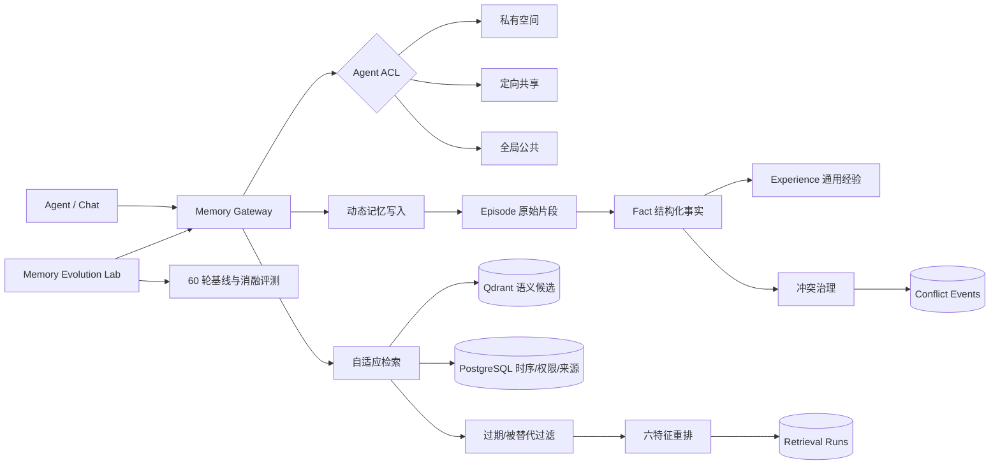
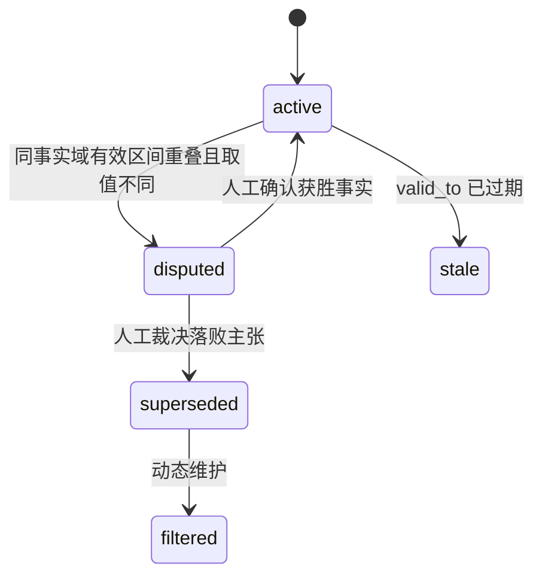

# 系统架构

## 数据协议

| 维度 | 字段 | 作用 |
|---|---|---|
| 分层 | `memory_layer` | `episode` / `fact` / `experience` |
| 溯源 | `source_memory_ids`, `episode_id`, `source_type` | 从经验追溯到事实、从事实追溯到原始交互 |
| 时序 | `occurred_at`, `valid_from`, `valid_to` | 区分记录时间、发生时间和事实有效区间 |
| 场景 | `scene_tags` | 面向开放域场景路由和加权 |
| 权限 | `owner_agent_id`, `memory_scope` | 私有、共享、公共空间 |
| 事实 | `fact_key`, `fact_value` | 同一事实键的新旧值进入冲突治理 |
| 证据 | `source_trust`, `access_count`, `importance` | 冲突和检索联合评分 |
| 状态 | `conflict_status`, `retention_status`, `superseded_by` | 争议、替代、过期和过滤 |
| 派生有效性 | `derivation_stale` | 来源变更后待复核，不能通过普通同步重新激活 |

## 权限判定

- 私有：仅 `owner_agent_id` 可读。
- 定向共享：所有者及 `memory_access_grants` 中 `can_read=true` 的 Agent 可读。
- 全局公共：同一用户工作区内的已注册 Agent 可读。
- Qdrant 只做候选召回；最终结果必须回到 PostgreSQL 进行用户、Agent、ACL 与状态二次校验。

## 冲突状态机

当前在线策略不按可信度、时间或频次评分自动判定事实真伪；不同主张保留为争议。加权自动裁决只属于历史离线实验，不代表生产策略。人工裁决后若仍有其他冲突，获胜主张继续保持争议。

冲突按用户、业务作用域、事实键及兼容权限域比较：私有记录仅同所有者比较，公共记录可跨 Agent，定向共享要求读者集合一致。详见[并发写入协议](../memory-write-consistency.md)。新派生经验还需通过来源可用性检查，不能把包含失效或争议来源的摘要作为已确认事实。

## 在线检索与后台一致性

聊天、Gateway HTTP 和 MCP 共用 `llm/retrieval.rs`：词法与向量各最多 200 个候选，PostgreSQL 为权限与状态的最终边界；词法使用 GIN 词项重叠，而非 BM25。显式 `as_of` 查询有效时间，不恢复历史 ACL，也不是当时已知信息的完整快照。

写入事务通过触发器维护 `memory_index_jobs`，后台租约、版本检查与重试提供最终一致性。离线合并最多读取 64 条候选、约 24000 字符，并在提交前重新检查来源。来源变更递归标记派生摘要待复核；正文仍可供管理追溯，但不参与召回。实现与限制见[优化说明](../memory-retrieval-optimization.md)。
