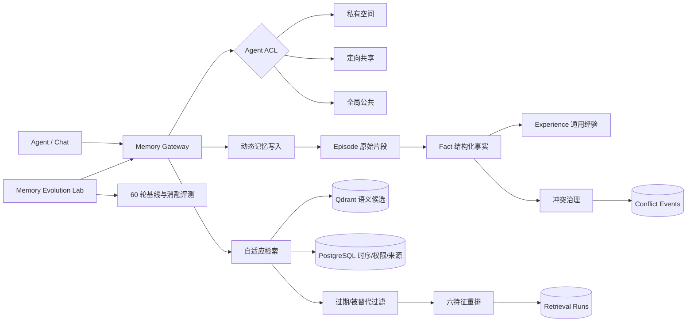
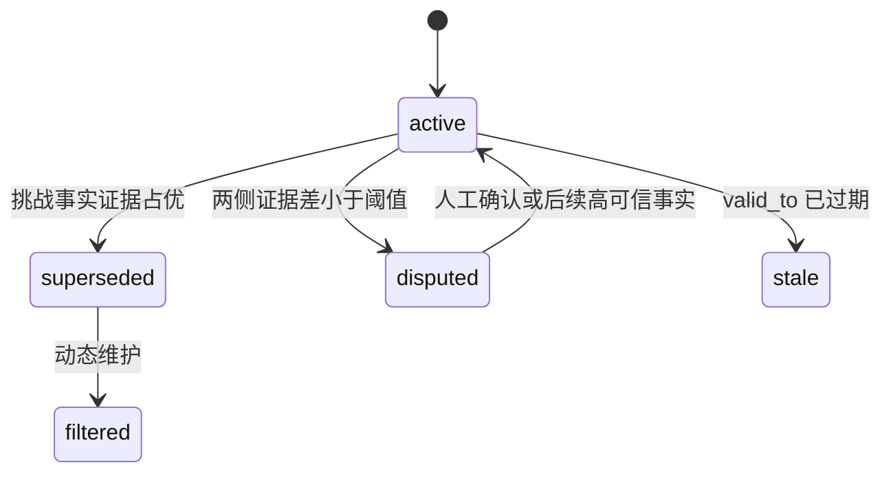

# 系统架构

## 数据协议

| 维度 | 字段 | 作用 |
|---|---|---|
| 分层 | `memory_layer` | `episode` / `fact` / `experience` |
| 溯源 | `source_memory_ids`, `episode_id`, `source_type` | 从经验追溯到事实、从事实追溯到原始交互 |
| 时序 | `occurred_at`, `valid_from`, `valid_to` | 区分记录时间、发生时间和事实有效区间 |
| 场景 | `scene_tags` | 面向开放域场景路由和加权 |
| 权限 | `owner_agent_id`, `memory_scope` | 私有、共享、公共空间 |
| 事实 | `fact_key`, `fact_value` | 同一事实键的新旧值进入冲突治理 |
| 证据 | `source_trust`, `access_count`, `importance` | 冲突和检索联合评分 |
| 状态 | `conflict_status`, `retention_status`, `superseded_by` | 争议、替代、过期和过滤 |

## 权限判定

- 私有：仅 `owner_agent_id` 可读。
- 定向共享：所有者及 `memory_access_grants` 中 `can_read=true` 的 Agent 可读。
- 全局公共：同一用户工作区内的已注册 Agent 可读。
- Qdrant 只做候选召回；最终结果必须回到 PostgreSQL 进行用户、Agent、ACL 与状态二次校验。

## 冲突状态机

综合证据分数：`0.55 × 来源可信度 + 0.25 × 时间新鲜度 + 0.10 × 访问频次 + 0.10 × 重要性`。分差绝对值不超过 `0.08` 时进入争议队列，避免低证据更新直接覆盖。

