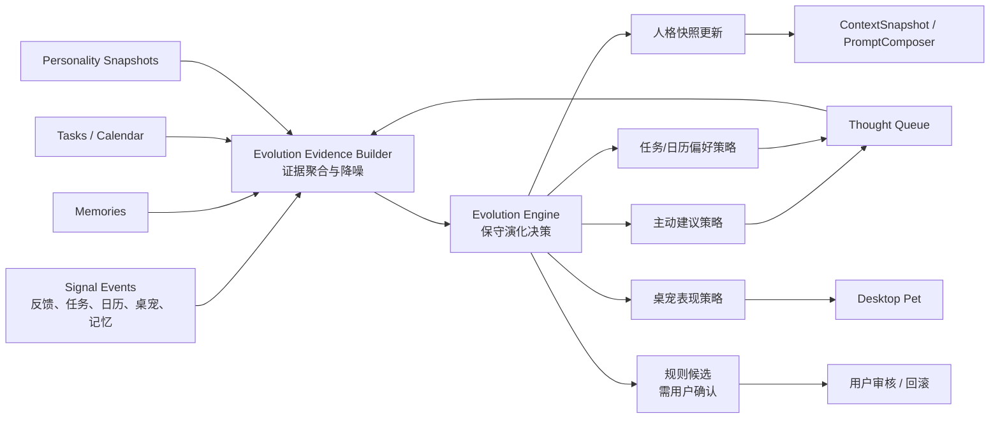

# 灵枢自进化机制设计

日期：2026-07-03

## 目标

灵枢需要在长期使用中逐步变得更贴合用户，而不是每次都像一个全新助手。这里的“自进化”不是让模型自行改写系统规则或越权执行操作，而是让系统基于可审计证据，保守地调整回答风格、主动建议策略、任务和日历提醒策略，以及桌宠表现。

本设计采用中等范围：

- 人格和回答风格可以自动小步演化。
- Thought Queue 的建议类型、频率和时机可以自动调节。
- 任务和日历策略可以学习用户偏好，但创建、修改、删除等真实操作仍必须走确认流。
- 桌宠表现可以跟随人格和状态变化。
- 系统提示词、身份边界、权限规则只能生成候选建议，不能自动启用。

## 当前代码基础

现有代码已经具备自进化雏形：

- `crates/lingshu-server/src/llm/personality.rs` 已有基于长期记忆的人格演化引擎，包含置信度门槛、单轮最大变化幅度和 24 小时自动触发冷却。
- `crates/lingshu-server/migrations/20260604000012_create_personality_snapshots_table.sql` 已记录人格快照、变化原因、来源记忆和当前激活状态。
- `crates/lingshu-server/src/telemetry.rs` 和 `signal_events` 已提供 append-only 事件层，并限制客户端可写事件类型。
- `crates/lingshu-server/src/llm/thoughts.rs` 已基于最近对话、目标、任务和实体统计生成主动建议，并有置信度、去重、活跃数量上限和冷却。
- `crates/lingshu-server/src/routes/chat.rs` 已在对话后的后台任务中触发记忆抽取、人格演化、Thought Queue 生成、遗忘和记忆合并。
- `docs/superpowers/specs/2026-06-12-lingshu-module-linkage-design.md` 已定义 `ContextSnapshot`、`Signal Bus`、`Command Bus`、`Personality Engine`、`Desktop Pet` 和 `Task/Thought Engine` 的整体联动结构。

因此本设计不重写架构，而是在现有联动结构上增加一个明确的 `Evolution Engine`。

## 总体结构



核心循环：

1. 用户对回答、主动建议、任务、日历和桌宠产生行为反馈。
2. 后端把关键行为写入 `signal_events`，高价值事实写入 `memories`。
3. `Evolution Evidence Builder` 定期聚合近期事件、长期记忆、任务处理习惯和 Thought Queue 结果。
4. `Evolution Engine` 只输出低风险策略变更，且每次变化有置信度、原因和证据来源。
5. 允许自动启用的变化进入人格、建议策略、提醒策略和桌宠表现。
6. 涉及系统规则、权限边界、身份设定的变化只生成候选，等待用户确认。

## 可自动演化的范围

### 1. 人格和回答风格

现有 7 个 trait 继续作为基础：

- `directness`
- `warmth`
- `proactivity`
- `risk_tolerance`
- `verbosity`
- `formality`
- `humor`

新增输入来源：

- `reply_thumb_up`
- `reply_thumb_down`
- `reply_style_tag`
- `personality_slider_changed`
- 被频繁引用或保护的长期记忆
- 用户反复要求的回答习惯，例如“直接说结论”“展开解释”“以后少提醒”

演化规则：

- 单轮 trait 最大变化继续限制在 `0.10` 以内。
- 低置信度不创建新快照。
- 需要把 `reply_style_tag` 纳入演化证据，而不是只依赖长期记忆。
- 手动 slider 的权重高于自动推断。
- 用户近期反向反馈可以覆盖旧趋势，但不能只凭一次反馈大幅改变。

输出：

- 新的 `personality_snapshots` 行。
- `change_reason` 写明变化来源。
- `source_memory_ids` 继续记录来源记忆。
- 额外信号记录演化发生、跳过原因和主要证据摘要。

### 2. 主动建议策略

当前 Thought Queue 已能生成 0-3 条主动建议，但它更像一个固定策略。自进化后需要学习用户是否喜欢某类建议。

建议新增一个服务端策略层，先不一定新增表，可以从 `signal_events` 动态计算：

- 用户接受任务规划类建议较多时，提高同类建议优先级。
- 用户连续 dismiss 某类建议时，延长同类建议冷却。
- 用户经常 snooze 某类建议时，把建议推迟到更合适的时间段。
- 用户长期不处理 pending/shown 建议时，降低整体主动性或减少一次生成数量。

策略输出：

- `max_new_thoughts` 的用户级有效值。
- 不同建议类别的权重。
- 同类建议 suppression 天数。
- 建议展示时机，例如工作日白天、日历事件前后、任务截止日前。

实现边界：

- Thought 内容仍由 LLM 生成并经过现有置信度、去重和 active cap。
- 策略只调节“要不要生成、生成哪类、什么时候展示”，不直接执行任务或日历操作。

### 3. 任务和日历策略

任务和日历是自进化最容易产生真实副作用的模块，必须明确边界。

允许自动学习：

- 用户常用的提醒提前量，例如 10 分钟、30 分钟、1 天。
- 用户偏好的任务拆分粒度。
- 用户倾向的时间块长度。
- 用户是否喜欢把模糊目标转成任务。
- 用户接受或拒绝日程建议的模式。

不允许自动执行：

- 自动创建日历事件。
- 自动删除或修改日历事件。
- 自动完成任务。
- 自动对外发送消息或操作第三方应用。

输出方式：

- 生成带理由的 `Thought`。
- 进入 `Command Bus` 确认流。
- 确认后才创建或修改任务、日历。
- 确认结果再写回 `signal_events`，成为下一轮策略证据。

### 4. 桌宠表现策略

桌宠应反映系统状态和人格演化，但不承担业务权限。

允许自动变化：

- 动画节奏、眨眼频率、回弹强度等表现参数。
- 在用户接受主动建议较多时，适当提高低打扰提示频率。
- 在用户多次 dismiss 后，降低提示频率并改为更安静的状态。
- 回答完成后根据反馈和人格进入 `happy`、`idle` 或 `sleepy`。

不允许：

- 桌宠点击后直接执行高风险动作。
- 桌宠绕过主窗口确认流。
- 桌宠持有独立业务状态并与后端状态分叉。

## 新增概念

### Evolution Evidence Builder

职责：把原始信号整理成模型和规则都能使用的证据包。

输入：

- 最近 N 天 `signal_events`。
- 高重要度 `memories`。
- 当前 active personality snapshot。
- Thought Queue 的 shown、confirmed、dismissed、expired 记录。
- 任务完成、延期、逾期和日历确认结果。

输出建议结构：

```rust
pub struct EvolutionEvidence {
    pub user_id: Uuid,
    pub window_days: i32,
    pub style_feedback: StyleFeedbackSummary,
    pub suggestion_feedback: SuggestionFeedbackSummary,
    pub task_calendar_preferences: TaskCalendarPreferenceSummary,
    pub memory_evidence: Vec<MemoryEvidence>,
    pub current_traits: PersonalityTraits,
}
```

要求：

- 只读，不写业务状态。
- 聚合摘要不包含完整敏感正文。
- 单次异常行为不能主导演化。
- 每个结论尽量带数量、时间窗口和来源。

### Evolution Engine

职责：根据证据包生成保守的策略变更。

输出分两类：

- `AutoApplicableChange`：低风险，可自动启用，例如人格小幅变化、建议冷却、桌宠表现参数。
- `ReviewRequiredChange`：需要用户确认，例如系统提示词候选、权限策略候选、跨模块默认行为变更。

自动启用门槛：

- 有足够样本量。
- 置信度达到阈值。
- 变化幅度低于上限。
- 不涉及权限扩大。
- 可回滚到上一状态。

### Evolution Ledger

当前 `personality_snapshots` 只记录人格变化。为了让其它策略也可审计，建议新增演化台账。

建议表：

```sql
CREATE TABLE evolution_runs (
    id UUID PRIMARY KEY DEFAULT gen_random_uuid(),
    user_id UUID NOT NULL REFERENCES users(id) ON DELETE CASCADE,
    scope VARCHAR(40) NOT NULL,
    status VARCHAR(20) NOT NULL,
    evidence_summary JSONB NOT NULL DEFAULT '{}',
    proposed_changes JSONB NOT NULL DEFAULT '[]',
    applied_changes JSONB NOT NULL DEFAULT '[]',
    skipped_reason TEXT,
    created_at TIMESTAMPTZ NOT NULL DEFAULT NOW()
);
```

用途：

- 展示“为什么灵枢变了”。
- 支持调试和回滚。
- 避免策略变化只能从日志里追。
- 为后续用户审查界面提供数据。

## 数据流

### 对话后的自动演化

1. 用户完成一轮对话。
2. `chat.rs` 后台任务照常抽取记忆、生成 Thought、触发人格演化。
3. 新增 `Evolution Evidence Builder` 读取反馈事件和相关业务状态。
4. `Evolution Engine` 生成候选变化。
5. 低风险变化写入对应策略存储和 `evolution_runs`。
6. 需要确认的变化写入 `evolution_runs`，状态为 `review_required`。
7. 下一轮 `ContextSnapshot` 和 `PromptComposer` 读取最新人格和策略。

### 用户反馈回答太长

1. 前端写入 `reply_style_tag`，metadata 为 `{ "tag": "too_long" }`。
2. Evidence Builder 在近期窗口内统计同类反馈。
3. 如果样本足够，Evolution Engine 小幅降低 `verbosity`。
4. 新 snapshot 生效后，下一轮 prompt 更偏简洁。
5. `evolution_runs` 记录证据数量和变化幅度。

### 用户反复拒绝任务建议

1. Thought Queue 写入 `thought_dismissed` 或状态变更。
2. Evidence Builder 发现某类任务规划建议连续被拒绝。
3. Suggestion Policy 延长同类建议冷却，降低任务规划类权重。
4. 未来仍可生成，但更少、更晚、更需要高置信度。

### 用户接受日历安排建议

1. 用户确认一个 Thought 转日历事件。
2. Command Bus 创建日历事件并写入结果信号。
3. Evidence Builder 记录这类建议被接受。
4. Task/Calendar Policy 学习偏好的提前量和时间块长度。
5. 未来类似建议优先展示，但仍进入确认流。

## API 与界面

最小可用版本不需要复杂新页面，但需要可见性和控制。

后端建议：

- `GET /api/v1/evolution/runs`：查看近期演化记录。
- `POST /api/v1/evolution/run`：手动触发一次演化。
- `POST /api/v1/evolution/runs/:id/approve`：批准需要确认的候选变化。
- `POST /api/v1/evolution/runs/:id/reject`：拒绝候选变化。
- `POST /api/v1/evolution/rollback`：回滚指定 scope 的最近一次自动变化。

前端建议：

- 在人格中心显示“最近一次自动调整”。
- 在 Thought Queue 或设置页显示“主动建议正在根据你的接受/拒绝调整”。
- 给用户一个总开关：关闭自动演化时，只记录候选，不自动应用。
- 对需要确认的规则候选提供接受/拒绝按钮。

## 权限和安全边界

必须坚持以下规则：

- 自进化不能扩大权限等级。
- 自进化不能让 LLM 绕过 Command Bus。
- 自进化不能直接执行任务、日历、文件、URL、自动化和第三方操作。
- 客户端只能提交白名单信号，服务端继续验证 metadata。
- 演化证据里不应保存完整敏感正文，只保存必要摘要、计数、标签和实体引用。
- 所有自动变化都必须可审计、可解释、可回滚。

## 错误处理

- LLM 演化调用失败：记录 warning 和 `evolution_runs.status = 'failed'`，不影响聊天主流程。
- 证据不足：记录 `skipped_reason = 'insufficient_evidence'`。
- 置信度不足：记录 `skipped_reason = 'low_confidence'`。
- 输出 JSON 解析失败：记录失败，不应用任何变化。
- 策略写入失败：事务回滚，保留失败记录。
- Redis、Qdrant 或其它辅助服务不可用：演化降级为只使用 PostgreSQL 证据。

## 实施顺序

### Phase 1：把现有人格演化接入反馈信号

- 扩展人格演化证据，从只看 memories 改为同时看 `reply_style_tag`、点赞、点踩和 slider 调整。
- 写入 `evolution_runs`，记录创建或跳过原因。
- 前端人格中心展示最近一次演化原因。

### Phase 2：主动建议策略自适应

- 给 Thought 增加类别或在 metadata 中记录建议类型。
- 根据 accepted、dismissed、snoozed、expired 调整类别权重和冷却。
- 保持现有 confidence、dedup、active cap。

### Phase 3：任务和日历偏好学习

- 记录任务建议和日历确认结果。
- 学习提醒提前量、时间块长度和拆分粒度。
- 让 Thought Queue 使用这些偏好生成更贴合的建议。
- 所有任务和日历写操作继续走确认。

### Phase 4：审查式规则候选

- 允许系统生成“建议调整默认提示词/规则”的候选。
- 只在用户批准后启用。
- 提供拒绝、回滚和查看证据。

## 测试策略

后端单元测试：

- Evidence Builder 能正确聚合 `reply_style_tag`、Thought 状态和任务/日历信号。
- 样本不足时不生成自动变化。
- 置信度不足时不写入策略。
- 单轮人格变化不超过上限。
- 手动 slider 权重高于自动推断。
- 客户端不能写入服务端专用演化信号。

后端集成测试：

- 对话后后台演化失败不影响聊天响应。
- 自动演化成功后能查询到 `evolution_runs`。
- 回滚后 active personality 或策略恢复到前一状态。
- Thought dismiss 多次后同类建议生成减少。
- 日历建议被接受后，未来同类建议仍需要确认。

前端测试：

- 人格中心正确展示最近演化原因。
- 自动演化开关关闭后，只生成候选不自动应用。
- 需要确认的规则候选可接受或拒绝。
- 任务/日历建议不会绕过确认按钮。

端到端验证：

- 用户连续反馈“太长”后，后续回答明显变短，且能在演化记录中看到原因。
- 用户连续拒绝某类 Thought 后，同类建议频率下降。
- 用户接受日历建议后，未来日历建议更贴合偏好但仍需要确认。
- 桌宠提示频率随用户接受/拒绝反馈变化，不影响业务权限。

## 非目标

本阶段不做以下事情：

- 让模型自动修改代码。
- 让模型自动改系统身份或安全规则并立即启用。
- 让桌宠直接执行高风险业务动作。
- 一次性重写 `chat.rs` 的所有 orchestration。
- 引入不可审计的长期黑箱策略。
- 把用户所有原始对话文本复制进演化记录。

## 结论

灵枢的自进化应是“证据驱动、保守调整、可审计回滚”的系统能力。第一阶段应复用现有人格演化、signal events 和 Thought Queue，把回答风格与主动建议真正接入反馈闭环；第二阶段再让任务和日历策略学习用户偏好；最后才加入需要用户审查的规则候选。这样可以让灵枢越来越贴合用户，同时保持权限、状态和真实操作的边界清晰。
